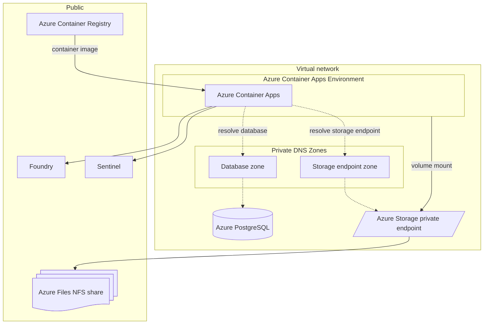
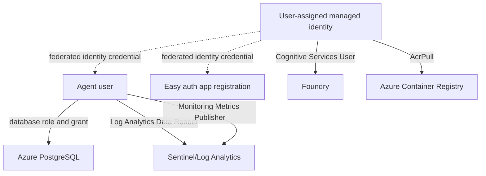
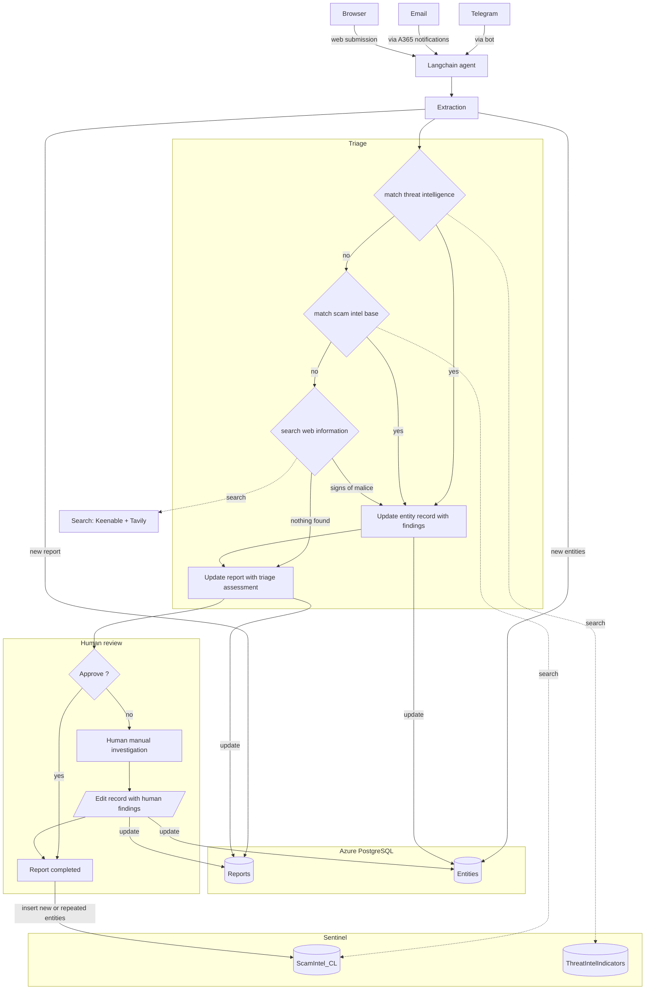

# ScamIntel

ScamIntel is a proof-of-concept agentic application on Azure Container Apps for a simulated use case of collecting and investigating citizen-submitted suspected scam reports across **Web**, **Email (Agent 365)**, and **Telegram** channels.

## 1. Architecture

### 1.1. High level components


### 1.2. Virtual network components



### 1.3. Identity and access management



## 2. Investigation Flow

1. **Intake:** The app stores the report as `pending`. Web and Telegram requests schedule triage in the app process; email handlers await triage before replying. Background work is not backed by a durable queue.
2. **Triage:** The app extracts URLs, domains, email addresses, IPv4 addresses, and phone numbers. It resolves domains and checks observables against `ThreatIntelIndicators` and `ScamIntel_CL`. If a Foundry model is configured, a LangChain agent can enrich unmatched entities with DNS, DNS blocklist, and configured Keenable or Tavily search tools. The app saves a versioned assessment and sets the report to `triaged`.
3. **Review and publication:** Staff can update entity findings and commit a verdict: `suspected_scam`, `likely_benign`, or `inconclusive`. The commit stores a new assessment and sets the report to `committed`. For `suspected_scam`, the app attempts to publish flagged entities and entities matched to `public_web` or `scamintel` to `ScamIntel_CL`. Publication happens after the database commit; a failed upload is reported separately and does not roll back the review.



## 3. Project components

### 3.1. Data model

| Table | Contents |
| --- | --- |
| `users` | Browser identities keyed by Entra tenant and object ID. |
| `reports` | Channel, source message ID, subject, body, processing status, and latest verdict. Email and Telegram reports have no linked browser user. |
| `entities` | Extracted indicators with match source, evidence, confidence, and publication flag. |
| `assessments` | Versioned automated and staff verdicts and rationales, with the reviewer ID where applicable. |

### 3.2. HTTP routes

Browser API calls use the identity supplied by Easy Auth. Mutating browser API requests require either `X-Requested-With` or `X-CSRF-Token`; if an `Origin` header is sent, its host must match the request host. `{id}` denotes a report UUID.

| Method | Path | Purpose |
| --- | --- | --- |
| `GET` | `/`, `/citizen`, `/staff` | Landing page, citizen portal, and staff console. |
| `GET` | `/health`, `/api/health` | HTTP liveness; returns `ok` without checking dependencies. |
| `GET` | `/api/me` | Return the signed-in user's profile. |
| `GET` | `/api/reports` | List the signed-in user's reports. |
| `POST` | `/api/reports` | Submit JSON with required `body_text` and optional `subject`; returns `201` with the new report. |
| `GET` | `/api/reports/{id}`, `/api/staff/reports/{id}` | Return the report, entities, and assessment history. |
| `GET` | `/api/staff/reports` | List reports across channels; accepts an optional `status` query parameter. |
| `POST` | `/api/staff/reports/{id}/commit` | Save a review with `verdict`, `rationale`, and optional `entities` updates; returns `detail` and `publication`. |
| `POST` | `/api/telegram/webhook` | Receive Telegram text or captions. Checks the Telegram secret header when configured. |
| `GET`, `POST` | `/api/messages` | GET is a no-op check; POST receives Microsoft 365 agent activities through the SDK adapter. |

> **Access control:** The current app authenticates browser API callers but does not enforce staff roles on staff APIs or report ownership on either report-detail route. Enforce those checks before allowing citizen and staff access to the same deployment. Keep the backend behind trusted authentication ingress that supplies the identity headers; do not accept caller-supplied identity headers from untrusted clients.

### 3.3. Configuration

| Area | Environment variables |
| --- | --- |
| HTTP | `HOST` (default `0.0.0.0`), `PORT` (`8080`), `LOG_LEVEL` (`INFO`). `ALLOW_DEV_AUTH` is for local testing only. |
| PostgreSQL | `PGHOST`, `PGUSER`, `PGDATABASE` (`scamintel`), `PGPORT` (`5432`), `PGSSLMODE` (`require`). With `PGPASSWORD` unset, the app requests an Entra Agent User token. |
| Azure AI Foundry | `FOUNDRY_PROJECT_ENDPOINT` and `FOUNDRY_MODEL` enable model-assisted triage; `UAMI_CLIENT_ID` selects the user-assigned managed identity. |
| Microsoft 365 Agents | `AGENTIC_INSTANCE_ID`, `AGENTIC_USER_ID`, and the five service-connection settings below. `TENANT_ID` is an app fallback and a deployment template input. |
| Azure Monitor | `LOG_ANALYTICS_WORKSPACE_ID` is the workspace ID used for queries. For ingestion, set `DCE_ENDPOINT` to the logs ingestion URL and `DCR_IMMUTABLE_ID` to the rule's immutable ID. `DCR_STREAM_NAME` defaults to `Custom-ScamIntel_CL`. |
| Public web search | `KEENABLE_API_KEY` and `TAVILY_API_KEY` enable their respective MCP search integrations. |
| Telegram | `TELEGRAM_BOT_TOKEN` is used for acknowledgement messages. Set `TELEGRAM_WEBHOOK_SECRET` to the same secret used when registering the webhook. |

For the federated Microsoft 365 Agents service connection shown in the deployment template, set:

| Variable | Value |
| --- | --- |
| `CONNECTIONS__SERVICE_CONNECTION__SETTINGS__AUTHORITY` | `https://login.microsoftonline.com/<tenant-id>` |
| `CONNECTIONS__SERVICE_CONNECTION__SETTINGS__AUTHTYPE` | `FederatedCredentials` |
| `CONNECTIONS__SERVICE_CONNECTION__SETTINGS__CLIENTID` | Agent blueprint client ID |
| `CONNECTIONS__SERVICE_CONNECTION__SETTINGS__FEDERATEDCLIENTID` | User-assigned managed identity client ID |
| `CONNECTIONS__SERVICE_CONNECTION__SETTINGS__TENANTID` | Entra tenant ID |

### 3.4. Repository layout

| File | Purpose |
| --- | --- |
| [`app.py`](app.py) | aiohttp application, intake handlers, PostgreSQL access, triage, and publishing. |
| [`index.html`](index.html), [`citizen.html`](citizen.html), [`staff.html`](staff.html) | Landing page, report portal, and staff console. |
| [`pyproject.toml`](pyproject.toml) | Python version and dependencies. |
| [`pg-tables.sql`](pg-tables.sql) | PostgreSQL schema and entity lookup index. |
| [`scamintel-dcr.json`](scamintel-dcr.json) | ARM template for the data collection rule and `Custom-ScamIntel_CL` stream. |
| [`Dockerfile`](Dockerfile), [`containerapp.yaml`](containerapp.yaml) | Dependency image and Azure Container Apps deployment template. |

## 4. Deployment

### 4.1. Prerequisites

#### 4.1.1. Azure infra

The project uses the following Azure infra services:
- Microsoft Foundry
- Azure Container Registry (ACR)
- Azure Container Apps environment
- Azure Files NFS share
- Azure PostgresSQL flexible server
- Azure networking: virtual network, subnet, private DNS zone, private endpoint

> The project shared infra base is adapted to the [Agent 365 samples write-up](https://github.com/joetanx/mslab/tree/main/agent-365/samples)
>
> This should likely be consolidated in the future into a separate *AgentsLab* setup documentation

#### 4.1.2. PostgreSQL tables

Acquire an Entra access token for Azure Database for PostgreSQL, connect via `psql`, and create the required tables:

```bash
export PGPASSWORD=$(az account get-access-token \
  --resource https://ossrdbms-aad.database.windows.net \
  --query accessToken \
  --output tsv)

psql -h <postgres-fqdn> -p 5432 -U <user-name> -d <dbname> -f pg-tables.sql
```

#### 4.1.3. Microsoft Sentinel (`ScamIntel_CL` Table, DCE, and DCR)

1. **Create the custom Log Analytics table `ScamIntel_CL`**:

```bash
az monitor log-analytics workspace table create \
  --resource-group "<ResourceGroupName>" \
  --workspace-name "<WorkspaceName>" \
  --name "ScamIntel_CL" \
  --plan Analytics \
  --retention-time 30 \
  --total-retention-time 90 \
  --columns \
    TimeGenerated=datetime \
    ReportEntityId=string \
    EntityType=string \
    EntityValue=string \
    EvidenceRef=string \
    Confidence=string \
    FirstObservedAt=datetime \
    LastObservedAt=datetime
```

2. **Create the Data Collection Endpoint (DCE)** and note its resource ID and `logsIngestion.endpoint` (`DCE_ENDPOINT`):

```bash
az monitor data-collection endpoint create \
  --resource-group "<ResourceGroupName>" \
  --location "<Location>" \
  --name "scamintel-dce" \
  --public-network-access Enabled

DCE_ID=$(az monitor data-collection endpoint show \
  --resource-group "<ResourceGroupName>" \
  --name "scamintel-dce" \
  --query id -o tsv)

az monitor data-collection endpoint show \
  --resource-group "<ResourceGroupName>" \
  --name "scamintel-dce" \
  --query logsIngestion.endpoint -o tsv
```

3. **Download and deploy the [scamintel-dcr.json](/scamintel-dcr.json) DCR ARM template** (matching `Custom-ScamIntel_CL` and linking to the DCE and Log Analytics workspace):


4. **Deploy the DCR and retrieve `immutableId` (`DCR_IMMUTABLE_ID`)**:

```bash
WORKSPACE_ID=$(az monitor log-analytics workspace show \
  --resource-group "<ResourceGroupName>" \
  --workspace-name "<WorkspaceName>" \
  --query id -o tsv)

az deployment group create \
  --resource-group "<ResourceGroupName>" \
  --template-file scamintel-dcr.json \
  --parameters \
    dataCollectionRuleName="scamintel-dcr" \
    workspaceResourceId="$WORKSPACE_ID" \
    endpointResourceId="$DCE_ID"

az monitor data-collection rule show \
  --resource-group "<ResourceGroupName>" \
  --name "scamintel-dcr" \
  --query immutableId -o tsv
```

#### 4.1.4. Identity and access

> draft notes here - to be updated

##### UAMI assignments

> Give the Container App's user-assigned managed identity `AcrPull` on ACR and model access on the Foundry resource. Configure the Agent blueprint's federated service connection for the Agent User; give that user query access to the workspace and `Monitoring Metrics Publisher` on the DCR.

##### Entra Agent Identity and Agent User

> a365 setup all -n $APP_DISPLAY_NAME
>
> az rest --method post --url "https://graph.microsoft.com/v1.0/users/microsoft.graph.agentUser" ....

##### Container Apps Easy Auth

> Configure browser login with Entra Easy Auth separately; it is not configured by [`containerapp.yaml`](containerapp.yaml). Ensure enabled intake webhooks can reach their routes without browser sign-in and use their own authentication.

#### 4.1.5. Telegram bot

> brief description of creating with bot with Telegram bot father

## 4.2. Deployment Steps

1. **Build & Push Image**:
   ```bash
   az acr build --registry $ACR_NAME --image scamintel:latest .
   ```
2. **Mount Application Files**: Upload `app.py`, `index.html`, `citizen.html`, and `staff.html` to the Azure Files NFS share mounted at `/app`.
3. **Deploy Container App**:
   ```bash
   envsubst < containerapp.yaml > /tmp/scamintel-aca.yaml
   az containerapp create --yaml /tmp/scamintel-aca.yaml
   ```
4. **Configure Easy Auth Excluded Paths**:
   Ensure `/`, `/index.html`, `/health`, `/api/health`, `/api/messages`, and `/api/telegram/webhook` are excluded in Container Apps Easy Auth (`authConfigs` `excludedPaths`) so splash page, health probes, and external webhooks are reachable without interactive login, while `/citizen`, `/staff`, and `/api/*` trigger Entra ID login.
5. **RBAC & Database Grants**:
   - **UAMI**: `AcrPull` on ACR, `Cognitive Services User` on Azure AI Foundry.
   - **Entra Agent User**: `Log Analytics Reader` and `Monitoring Metrics Publisher` on the Sentinel workspace/DCR, plus PostgreSQL Entra role grants on the `scamintel` database.
6. **Register Telegram Webhook**:
   ```bash
   curl -X POST "https://api.telegram.org/bot${TELEGRAM_BOT_TOKEN}/setWebhook" \
     -d "url=https://<app-fqdn>/api/telegram/webhook" \
     -d "secret_token=${TELEGRAM_WEBHOOK_SECRET}"
   ```
