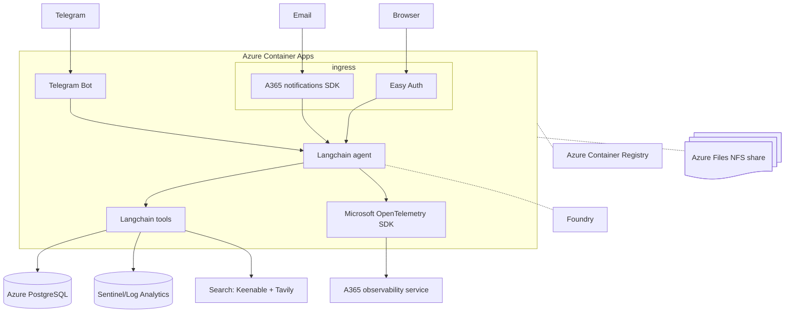
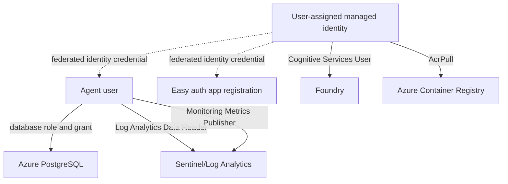

# ScamIntel PoC

ScamIntel is a proof-of-concept agentic application on Azure Container Apps for collecting and investigating citizen-submitted suspected scam reports across **Web**, **Email (Agent 365)**, and **Telegram** channels.

## High level components



## Virtual network components


## Identity and access management



## Mounted `/app` Layout

All application code and static HTML pages are mounted from an Azure Files NFS share into `/app`:

```text
/app/
├── app.py          # aiohttp server, PostgreSQL/Sentinel helpers, LangChain agent, webhooks
├── index.html      # Public splash page with Entra Easy Auth login & logout banner
├── citizen.html    # Citizen AJAX portal (submit report, track status)
└── staff.html      # Staff AJAX triage console (review, edit, commit, inline Sentinel publication)
```

`pyproject.toml` and `containerapp.yaml` live in the deployment repo (with `Dockerfile` baking the Python virtual environment from `pyproject.toml` while `/app` is volume-mounted at runtime).

## Investigation Flow

1. **Intake**: Citizens submit reports via Web (`POST /api/reports`), Email (`POST /api/messages` via M365 Agents SDK / A365 Notifications), or Telegram (`POST /api/telegram/webhook`).
2. **Deterministic Extraction & Lookups**: `investigate_report` extracts URLs, emails, domains, IPv4 addresses, and phone numbers (`extract_entities`), resolves domain IPs via `dnspython`, and queries Microsoft Sentinel `ThreatIntelIndicators` and `ScamIntel_CL` via `azure-monitor-query`.
3. **Agent Investigation**: Unmatched entities are investigated by a LangChain agent (`create_agent` with `ToolStrategy(TriageResult)`) using Azure AI Foundry, Keenable/Tavily remote MCP search tools, DNS lookup, and `dnspython` domain/MX DNSBL lookups (Spamhaus DBL/ZEN, SURBL, SpamCop, filtering out `127.255.255.*` resolver-block codes). If any check or the agent fails, the verdict degrades safely to `inconclusive` (never `likely_benign`).
4. **Staff Review & Commit**: Staff review triaged reports in `/staff`, optionally edit entity matches/flags or verdict/rationale, and commit (`POST /api/staff/reports/{id}/commit`). Flagged entities (`public_web` malice or repeated `scamintel` matches) are published to `ScamIntel_CL` via `azure-monitor-ingestion`.

## API Endpoints

| Method & Path | Auth / Protection | Purpose |
|---|---|---|
| `GET /` | Public | Login splash page (`index.html`), shows logout banner on `?logged_out=1` |
| `GET /citizen`, `GET /staff` | Easy Auth | Citizen and Staff AJAX UIs |
| `GET /health`, `GET /api/health` | Public | Container Apps health probe |
| `GET /api/me` | Easy Auth | Upserts and returns current `users` record |
| `GET /api/reports` | Easy Auth | List reports submitted by current user |
| `POST /api/reports` | Easy Auth + CSRF | Submit a new web report (`subject`, `body_text`) |
| `GET /api/reports/{id}` | Easy Auth | Get report detail, entities, and assessments |
| `GET /api/staff/reports` | Easy Auth | List all reports (optional `?status=`) |
| `GET /api/staff/reports/{id}` | Easy Auth | Get full report detail for staff review |
| `POST /api/staff/reports/{id}/commit` | Easy Auth + CSRF | Append staff assessment, update report, publish flagged indicators to Sentinel |
| `POST /api/telegram/webhook` | `X-Telegram-Bot-Api-Secret-Token` | Telegram Bot message intake |
| `POST /api/messages` | M365 Agents JWT | Agent 365 email notification & Bot Framework intake |

Non-GET `/api/*` endpoints (except webhooks) require a custom `X-Requested-With` (or `X-CSRF-Token`) header and same-host `Origin` check.

## Data Model

PostgreSQL tables must be created beforehand (see **Prerequisites** below):
- `users`, `reports`, `assessments` (as specified in `intent.md`)
- An append-only `entities` table (keyed by `id`, linked to `reports(id)`, indexed on `(type, value)`), with `confidence` (`low` | `medium` | `high`) and `flag_for_scamintel` (`boolean`). `FirstObservedAt` / `LastObservedAt` for `ScamIntel_CL` are computed via `MIN(reports.received_at)` / `MAX(reports.received_at)` across all rows matching `(type, value)`.
- **Added column on `assessments`**: `actor_user_id` (`UUID`, nullable) to link staff reviews to `users.id`.
- Flagged entities are published inline to `ScamIntel_CL` during `POST /api/staff/reports/{id}/commit`; any ingestion failure is logged with the failed payload without blocking the commit.

## Environment Variables

| Variable | Purpose |
|---|---|
| `HOST`, `PORT`, `LOG_LEVEL` | `aiohttp` listener (`0.0.0.0:8080`) and log verbosity |
| `FOUNDRY_PROJECT_ENDPOINT`, `FOUNDRY_MODEL`, `UAMI_CLIENT_ID` | Azure AI Foundry model & User-Assigned Managed Identity |
| `CONNECTIONS__SERVICE_CONNECTION__SETTINGS__*`, `AGENTIC_INSTANCE_ID`, `AGENTIC_USER_ID` | M365 Agents SDK / Entra Agent User federated credentials |
| `PGHOST`, `PGPORT`, `PGDATABASE`, `PGUSER`, `PGSSLMODE` | Azure PostgreSQL connection (uses Entra token; `PGPASSWORD` optional for local dev) |
| `LOG_ANALYTICS_WORKSPACE_ID`, `DCE_ENDPOINT`, `DCR_IMMUTABLE_ID`, `DCR_STREAM_NAME` | Sentinel Log Analytics query & `ScamIntel_CL` Logs Ingestion |
| `KEENABLE_API_KEY`, `TAVILY_API_KEY` | Keenable and Tavily remote MCP search API keys |
| `TELEGRAM_BOT_TOKEN`, `TELEGRAM_WEBHOOK_SECRET` | Telegram bot reply & webhook secret validation |
| `ALLOW_DEV_AUTH` | Set `"true"` only for local non-Easy-Auth testing |

## Prerequisites

### 1. PostgreSQL Database & Tables

Acquire an Entra access token for Azure Database for PostgreSQL, connect via `psql`, and create the required tables:

```bash
export PGPASSWORD=$(az account get-access-token \
  --resource https://ossrdbms-aad.database.windows.net \
  --query accessToken \
  --output tsv)

psql -h <postgres-fqdn> -p 5432 -U <user-name> -d <dbname>
```

Run the following SQL:

```sql
CREATE TABLE IF NOT EXISTS users (
    id UUID PRIMARY KEY,
    tenant_id TEXT NOT NULL,
    object_id TEXT NOT NULL,
    display_name TEXT,
    email TEXT,
    created_at TIMESTAMPTZ NOT NULL DEFAULT now(),
    last_login_at TIMESTAMPTZ NOT NULL DEFAULT now(),
    UNIQUE (tenant_id, object_id)
);

CREATE TABLE IF NOT EXISTS reports (
    id UUID PRIMARY KEY,
    reporter_user_id UUID NULL REFERENCES users(id),
    channel TEXT NOT NULL CHECK (channel IN ('web', 'email', 'telegram')),
    channel_message_id TEXT NOT NULL,
    received_at TIMESTAMPTZ NOT NULL DEFAULT now(),
    subject TEXT,
    body_text TEXT NOT NULL,
    processing_status TEXT NOT NULL DEFAULT 'pending',
    assessment TEXT,
    created_at TIMESTAMPTZ NOT NULL DEFAULT now(),
    updated_at TIMESTAMPTZ NOT NULL DEFAULT now()
);

CREATE TABLE IF NOT EXISTS entities (
    id UUID PRIMARY KEY,
    report_id UUID NOT NULL REFERENCES reports(id) ON DELETE CASCADE,
    type TEXT NOT NULL,
    value TEXT NOT NULL,
    created_at TIMESTAMPTZ NOT NULL DEFAULT now(),
    matches TEXT NOT NULL DEFAULT 'none' CHECK (matches IN ('scamintel', 'microsoft_ti', 'public_web', 'none')),
    evidence_ref TEXT,
    confidence TEXT NOT NULL DEFAULT 'medium' CHECK (confidence IN ('low', 'medium', 'high')),
    flag_for_scamintel BOOLEAN NOT NULL DEFAULT FALSE
);

CREATE INDEX IF NOT EXISTS idx_entities_type_value ON entities (type, value);

CREATE TABLE IF NOT EXISTS assessments (
    id UUID PRIMARY KEY,
    report_id UUID NOT NULL REFERENCES reports(id) ON DELETE CASCADE,
    version INTEGER NOT NULL,
    verdict TEXT NOT NULL CHECK (verdict IN ('suspected_scam', 'likely_benign', 'inconclusive')),
    rationale TEXT NOT NULL,
    actor_type TEXT NOT NULL CHECK (actor_type IN ('agent', 'staff')),
    actor_user_id UUID NULL REFERENCES users(id),
    created_at TIMESTAMPTZ NOT NULL DEFAULT now(),
    UNIQUE (report_id, version)
);
```

### 2. Microsoft Sentinel (`ScamIntel_CL` Table, DCE, and DCR)

1. **Create the custom Log Analytics table `ScamIntel_CL`**:

```bash
az monitor log-analytics workspace table create \
  --resource-group "<ResourceGroupName>" \
  --workspace-name "<WorkspaceName>" \
  --name "ScamIntel_CL" \
  --plan Analytics \
  --retention-time 30 \
  --total-retention-time 90 \
  --columns \
    TimeGenerated=datetime \
    ReportEntityId=string \
    EntityType=string \
    EntityValue=string \
    EvidenceRef=string \
    Confidence=string \
    FirstObservedAt=datetime \
    LastObservedAt=datetime
```

2. **Create the Data Collection Endpoint (DCE)** and note its resource ID and `logsIngestion.endpoint` (`DCE_ENDPOINT`):

```bash
az monitor data-collection endpoint create \
  --resource-group "<ResourceGroupName>" \
  --location "<Location>" \
  --name "scamintel-dce" \
  --public-network-access Enabled

DCE_ID=$(az monitor data-collection endpoint show \
  --resource-group "<ResourceGroupName>" \
  --name "scamintel-dce" \
  --query id -o tsv)

az monitor data-collection endpoint show \
  --resource-group "<ResourceGroupName>" \
  --name "scamintel-dce" \
  --query logsIngestion.endpoint -o tsv
```

3. **Download and deploy the [scamintel-dcr.json](/scamintel-dcr.json) DCR ARM template** (matching `Custom-ScamIntel_CL` and linking to the DCE and Log Analytics workspace):


4. **Deploy the DCR and retrieve `immutableId` (`DCR_IMMUTABLE_ID`)**:

```bash
WORKSPACE_ID=$(az monitor log-analytics workspace show \
  --resource-group "<ResourceGroupName>" \
  --workspace-name "<WorkspaceName>" \
  --query id -o tsv)

az deployment group create \
  --resource-group "<ResourceGroupName>" \
  --template-file scamintel-dcr.json \
  --parameters \
    dataCollectionRuleName="scamintel-dcr" \
    workspaceResourceId="$WORKSPACE_ID" \
    endpointResourceId="$DCE_ID"

az monitor data-collection rule show \
  --resource-group "<ResourceGroupName>" \
  --name "scamintel-dcr" \
  --query immutableId -o tsv
```

## Deployment Steps

1. **Build & Push Image**:
   ```bash
   az acr build --registry $ACR_NAME --image scamintel:latest .
   ```
2. **Mount Application Files**: Upload `app.py`, `index.html`, `citizen.html`, and `staff.html` to the Azure Files NFS share mounted at `/app`.
3. **Deploy Container App**:
   ```bash
   envsubst < containerapp.yaml > /tmp/scamintel-aca.yaml
   az containerapp create --yaml /tmp/scamintel-aca.yaml
   ```
4. **Configure Easy Auth Excluded Paths**:
   Ensure `/`, `/index.html`, `/health`, `/api/health`, `/api/messages`, and `/api/telegram/webhook` are excluded in Container Apps Easy Auth (`authConfigs` `excludedPaths`) so splash page, health probes, and external webhooks are reachable without interactive login, while `/citizen`, `/staff`, and `/api/*` trigger Entra ID login.
5. **RBAC & Database Grants**:
   - **UAMI**: `AcrPull` on ACR, `Cognitive Services User` on Azure AI Foundry.
   - **Entra Agent User**: `Log Analytics Reader` and `Monitoring Metrics Publisher` on the Sentinel workspace/DCR, plus PostgreSQL Entra role grants on the `scamintel` database.
6. **Register Telegram Webhook**:
   ```bash
   curl -X POST "https://api.telegram.org/bot${TELEGRAM_BOT_TOKEN}/setWebhook" \
     -d "url=https://<app-fqdn>/api/telegram/webhook" \
     -d "secret_token=${TELEGRAM_WEBHOOK_SECRET}"
   ```
